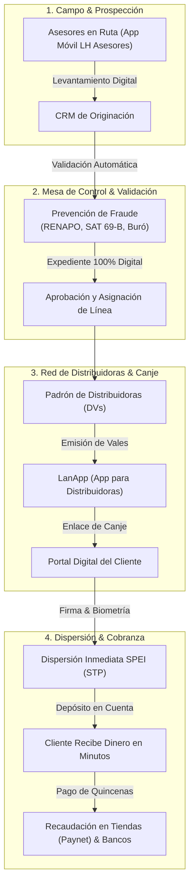

# LanAhora SystemCore — Plataforma Integral de Crédito y Operaciones

Bienvenido a la documentación general de **LanAhora SystemCore**, la plataforma digital integral diseñada para respaldar, agilizar y modernizar el modelo de colocación, administración y cobranza de microcréditos mediante vales en México.

---

## 🎯 ¿Qué es LanAhora SystemCore?

**LanAhora SystemCore** es el ecosistema operativo y tecnológico de **LanAhora (SOFOM E.N.R.)**. Conecta en una sola plataforma segura y en tiempo real a:

* **Dirección General y Mesas de Control**: Para monitorear la salud financiera, dispersiones y cumplimiento regulatorio.
* **Coordinadores y Gerentes de Sucursal**: Para supervisar la cobranza, autorizar expedientes y coordinar equipos.
* **Asesores de Campo**: Equipados con su aplicación móvil para prospectar clientes en ruta y validar identidades al instante.
* **Distribuidoras (DVs)**: Que administran sus líneas de crédito, emiten vales digitales y consultan sus estados de cuenta quincenales desde su propia app (**LanApp**).
* **Clientes Finales**: Quienes reciben préstamos ágiles, firman digitalmente y disponen de su dinero en minutos vía transferencia electrónica bancaria o en comercios afiliados.

---

## 🏛️ Los Pilares del Sistema

---

## 📦 Módulos Principales

### 1. CRM & Originación Comercial (Cero Papel)
* **Tablero Kanban de Crédito**: Seguimiento visual paso a paso de cada prospecto a través de sus etapas reglamentarias: Contacto inicial, Visita ocular en domicilio/negocio, Consulta en Buró, Integración de expediente, Mesa de Control y Autorización final.
* **Expediente Digital Centralizado**: Almacena de forma ordenada y encriptada los 25 documentos de respaldo requeridos (identificaciones oficiales, comprobantes de domicilio, fotos de fachada/interior, cartas de aval y contratos).
* **Dictamen de Capacidad**: Clasificación automática del perfil de la distribuidora según su nivel de solvencia y experiencia previa.

### 2. Padrón Central de Personas y Expediente Digital
* **Búsqueda Instantánea**: Localización ágil de clientes y distribuidores entre más de 120,000 registros por nombre, CURP o número de expediente.
* **Historial Completo**: Visualización de antecedentes crediticios, pagarés firmados, documentación digitalizada y cartas declaratorias.
* **Gestión de Estatus**: Activación, asignación de roles y actualización de datos bancarios con un clic.

### 3. Red de Distribuidoras (DVs)
* **Control Integral de Cartera**: Consulta de líneas de crédito activas, saldo actual, disponibilidad para emisión de vales y estatus de cobranza.
* **Estados de Cuenta Oficiales**: Generación y descarga inmediata de estados de cuenta detallados con desglose de cargos, pagos y comisiones.
* **Relación de Cobro Quincenal**: Listados ordenados por coordinador y sucursal para agilizar el corte y la cobranza en campo.
* **Comunicación Directa**: Envío de avisos oficiales, notificaciones push a la aplicación móvil y recordatorios vía WhatsApp.

### 4. Validación de Identidad y Prevención de Fraude (KYC & Cumplimiento)
* **Validación RENAPO**: Comprobación oficial de existencia, vigencia y coherencia de datos de la Clave Única de Registro de Población (CURP).
* **Filtro de Listas Negras del SAT (Art. 69-B)**: Verificación instantánea contra el padrón oficial de contribuyentes no localizados, presuntos o definitivos por operaciones simuladas.
* **Consulta en Buró de Crédito**: Conexión directa para obtener el Score crediticio (FICO) y comportamiento de pago previo en segundos.

### 5. Dispersión Automática SPEI y Recaudación de Pagos
* **Dispersión Inmediata 24/7 (STP SPEI)**: Envío automático del dinero a la cuenta bancaria (CLABE o tarjeta) del cliente en minutos una vez completado el canje. Generación de clave de rastreo oficial para consulta en Banxico.
* **Red de Cobranza en Tiendas (Paynet)**: Generación de códigos de barras para que los clientes o distribuidoras realicen sus abonos cómodamente en más de 30,000 establecimientos en todo el país (7-Eleven, Farmacias del Ahorro, Circle K, Walmart y ventanillas bancarias).

### 6. Aplicaciones Móviles Oficiales

#### 📱 LanApp (Para Distribuidoras y Canje del Cliente)
* **Para la Distribuidora**:
  * Consulta en tiempo real de su saldo disponible y fechas de corte.
  * Emisión de vales de dinero digitales especificando monto y quincenas.
  * Generación de enlaces seguros para enviar a sus clientes por WhatsApp.
* **Para el Cliente Final (Canje Digital)**:
  * Proceso de autoservicio desde el navegador de su teléfono:
    1. Confirmación de datos personales y beneficiario de seguro de vida.
    2. Captura en vivo de fotografía de su credencial INE (anverso y reverso) con lectura automática de datos.
    3. Validación facial biométrica (selfie con detección de vida).
    4. Firma digital del pagaré en pantalla táctil.
    5. Depósito automático directo a su cuenta de banco.

#### 📱 LH Asesores (Para Asesores Comerciales en Ruta)
* **Levantamiento en Campo**: Registro de nuevas solicitudes de crédito directamente en el domicilio o negocio del prospecto, sin necesidad de cargar papelería física.
* **Validación en Frío**: Verificación de CURP en tiempo real durante la entrevista para descartar homónimos o adeudos previos antes de armar expediente.
* **Asistencia y Geolocalización**: Registro de visita con coordenadas GPS para transparentar la cobertura de zonas comerciales asignadas.

### 7. Capital Humano & Gestión de Talento
* **Control de Asistencia**: Registro de entradas, salidas y presencia en sucursales y brigadas de campo con verificación satelital GPS.
* **Requisiciones Internas**: Solicitud ágil de uniformes institucionales, chalecos de campo, gafetes y materiales de trabajo.
* **Capacitaciones Obligatorias**: Seguimiento a certificaciones normativas en Prevención de Lavado de Dinero (PLD) y servicio al cliente.

---

## 🌟 Beneficios Principales

| Para la Financiera (LanAhora) | Para las Distribuidoras (DVs) | Para los Clientes Finales |
| :--- | :--- | :--- |
| **Cero Pérdida de Papel**: Todo el expediente es digital y trazable. | **Independencia Total**: Emisión de vales las 24 horas sin filas en sucursal. | **Rapidez Extrema**: Dinero en su cuenta bancaria en cuestión de minutos. |
| **Blindaje contra Fraudes**: Verificación con RENAPO, SAT 69-B y biometría. | **Control Financiero**: Estado de cuenta y cobranza disponible en su celular. | **Facilidad de Pago**: Abonos en tiendas de conveniencia de su colonia. |
| **Dispersión Automatizada**: Sin cheques ni manejo de efectivo en sucursales. | **Comisiones Transparentes**: Visualización de ganancias por colocación. | **Seguridad**: Proceso protegido con biometría y firma electrónica. |

---

## 🔒 Compromiso con la Seguridad y Privacidad

LanAhora opera bajo las mejores prácticas del sector financiero:
* **Cifrado de Extremo a Extremo**: Toda la información transmitida entre el celular, la web y los servidores bancarios viaja protegida mediante protocolos criptográficos modernos (TLS 1.3).
* **Protección de Datos Personales**: Cumplimiento estricto con la Ley Federal de Protección de Datos Personales en Posesión de los Particulares (LFPDPPP).
* **Auditoría Permanente**: Cada consulta, autorización de crédito o dispersión deja un registro inalterable (bitácora de auditoría) con fecha, hora, usuario y dirección IP.

---

## ❓ Preguntas Frecuentes (FAQ)

### ¿Se necesita una computadora potente para usar el sistema Core?
No. SystemCore está desarrollado con tecnología web de última generación optimizada para cargar en milisegundos en cualquier navegador moderno (Google Chrome, Microsoft Edge, Safari o Firefox), ya sea en computadoras de escritorio, laptops o tabletas.

### ¿Qué pasa si un asesor pierde la conexión a internet en campo?
La aplicación móvil de asesores cuenta con almacenamiento local seguro en el dispositivo, permitiendo avanzar en la captura de datos y fotografías para sincronizarlas en cuanto recupere cobertura celular o señal Wi-Fi.

### ¿Cómo sabe el cliente final que su dinero ya fue depositado?
En cuanto el cliente concluye la firma digital y la prueba de vida en el portal de canje, el motor SPEI realiza la transferencia en tiempo real y el cliente recibe confirmación en pantalla junto con su comprobante digital y clave de rastreo.
