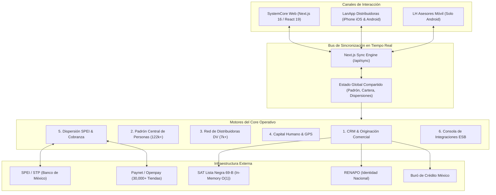
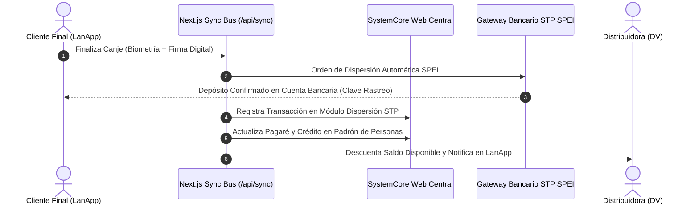

# 🚀 LANAHORA SYSTEMCORE
## Presentación Ejecutiva y Arquitectura Integral de Operaciones
**LanAhora (SOFOM E.N.R.) — Plataforma Tecnológica de Microcréditos por Vales**

---

```
  ========================================================================================
   LANAHORA SYSTEMCORE — PRESENTACIÓN EJECUTIVA DEL ECOSISTEMA
  ========================================================================================
```

---

## 📑 Índice de Contenidos

1. [Diapositiva 1: Visión General & Propósito](#diapositiva-1-visión-general--propósito)
2. [Diapositiva 2: Panorama del Ecosistema Tecnológico](#diapositiva-2-panorama-del-ecosistema-tecnológico)
3. [Diapositiva 3: Módulos del Sistema Central Web](#diapositiva-3-módulos-del-sistema-central-web)
4. [Diapositiva 4: Ecosistema Móvil (LanApp & LH Asesores)](#diapositiva-4-ecosistema-móvil-lanapp--lh-asesores)
5. [Diapositiva 5: Flujo de Canje Digital Autónomo & Motor Biométrico](#diapositiva-5-flujo-de-canje-digital-autónomo--motor-biométrico)
6. [Diapositiva 6: Matriz de Integración y Sincronización en Tiempo Real](#diapositiva-6-matriz-de-integración-y-sincronización-en-tiempo-real)
7. [Diapositiva 7: Blindaje Normativo, Prevención de Fraude & KYC](#diapositiva-7-blindaje-normativo-prevención-de-fraude--kyc)
8. [Diapositiva 8: Red Financiera (Dispersión STP SPEI & Recaudación Paynet)](#diapositiva-8-red-financiera-dispersión-stp-spei--recaudación-paynet)
9. [Diapositiva 9: Impacto en el Negocio, Eficiencia & ROI](#diapositiva-9-impacto-en-el-negocio-eficiencia--roi)
10. [Diapositiva 10: Conclusiones & Roadmap](#diapositiva-10-conclusiones--roadmap)

---

## Diapositiva 1: Visión General & Propósito

### 🎯 La Transformación del Crédito por Vales
Tradicionalmente, el modelo de crédito mediante vales ha dependido de papel físico, traslados a sucursales, cheques y altos riesgos de suplantación de identidad o cartera vencida.

**LanAhora SystemCore** transforma este modelo tradicional en una **Fintech moderna de alta escala**:
* **100% Digital y Cero Papel**: Expedientes, pagarés y contratos firmados electrónicamente.
* **Dispersión Inmediata 24/7**: Depósito bancario por SPEI en minutos directamente a la cuenta del cliente.
* **Blindaje contra Fraude**: Validación biométrica facial en vivo y cruce preventivo con listas del SAT (Art. 69-B) y RENAPO.
* **Autonomía para la Red de Distribuidoras**: Emisión de vales las 24 horas del día desde el teléfono celular.

---

## Diapositiva 2: Panorama del Ecosistema Tecnológico



---

## Diapositiva 3: Módulos del Sistema Central Web

El portal administrativo **SystemCore** unifica todas las áreas clave de la compañía:

| Módulo | Alcance Operativo | Capacidades Clave |
| :--- | :--- | :--- |
| **1. CRM & Originación** | Gestión comercial de prospectos y distribuidoras | Tablero Kanban con Drag & Drop interactivo, matriz documental de 25 requisitos, dictamen de perfil crediticio y capacidad de pago. |
| **2. Padrón de Personas** | Registro maestro de clientes y beneficiarios | Consulta de más de 122,000 registros, estatus de pagarés en blanco, validación de buró interno y expediente digital. |
| **3. Red de Distribuidores & Perfil DV** | Control de más de 7,000 distribuidoras | Ficha técnica integral (DV #1053), 25 opciones operativas, líneas autorizadas, estados de cuenta y Relación de Cobranza Oficial (3 líneas, 7 vales, bonificación 18%). |
| **4. Mesa de Crédito** | Control de riesgos y dictamen colegiado | Validación documental, verificación biométrica, semaforización de capacidad de pago y autorización de emisión de vales. |
| **5. Gestoría de Cobranza** | Recuperación y convenios de pago | Bitácora de gestoría en campo, promesas de pago con fecha límite, alertas de mora y acuerdos de reestructuración. |
| **6. Capital Humano (RH)** | Administración del equipo y asesores en ruta | Control de asistencia satelital por GPS, asignación de zonas, requisición de materiales y seguimiento a capacitaciones normativas. |
| **7. Dispersión & Tesorería** | Tesorería automatizada y recaudación | Dispersión masiva vía STP SPEI 24/7, conciliación bancaria en tiempo real, gestión de referencias de pago Paynet. |
| **8. Contabilidad & Pólizas** | Cumplimiento fiscal y financiero | Catálogo de cuentas CNBV, pólizas contables automatizadas (diario, ingresos, egresos) y conciliación de saldos. |
| **9. Prevención PLD/FT** | Blindaje regulatorio CNBV / UIF | Matriz de riesgo, validación continua SAT 69-B / PEPs, monitoreo de operaciones inusuales y buzón confidencial. |
| **10. Integraciones (ESB)** | Salud tecnológica y conectividad externa | Consola de monitoreo de microservicios, conexión a RENAPO, SAT 69-B, Buró de Crédito y pasarelas bancarias. |

---

## Diapositiva 4: Ecosistema Móvil (LanApp para iPhone/Android & LH Asesores solo Android)

Desarrolladas con **Flutter** para máximo desempeño nativo:

### 📱 1. LanApp (`com.lanahora.lanapp`) — iPhone iOS & Google Android
* **Compatibilidad Multiplataforma**: Disponible tanto para **Apple iPhone (iOS 15+)** (con soporte nativo para **Face ID**, Touch ID y apertura de WhatsApp) como para teléfonos **Android**.
* **Para la Distribuidora (DV)**:
  * Consulta en vivo de su línea disponible, saldo actual y fechas de corte.
  * Emisión de vales digitales en segundos eligiendo cliente, monto y plazos.
  * Compartición de enlaces de canje seguro mediante WhatsApp.
* **Para el Cliente Final (Portal de Canje Digital)**:
  * Experiencia guiada paso a paso para formalizar su préstamo en su propio smartphone.
  * Captura de credencial INE y validación facial biométrica con detección de vida.
  * Firma digital en pantalla y acreditación bancaria inmediata.

### 📱 2. LH Asesores (`com.lanahora.asesores`) — Solo Android
* **Exclusiva para Flota Android de Campo**:
  * Diseñada específicamente para los terminales y smartphones Android provistos a la fuerza de ventas.
  * Levantamiento de solicitudes en campo directamente en domicilios o comercios.
  * Validación preventiva de CURP contra listas negras del SAT antes de integrar expediente.
  * Marcaje de asistencia con geolocalización satelital GPS para asegurar cobertura geográfica.

---

## Diapositiva 5: Flujo de Canje Digital Autónomo & Motor Biométrico

El proceso de canje garantiza **cero suplantación de identidad** mediante un embudo de 17 pasos:

```
[Paso 8: Revisión de Condiciones] ──> [Paso 9: Domicilio] ──> [Paso 10: Beneficiario Seguro]
                                                                        │
┌───────────────────────────────────────────────────────────────────────┘
▼
[Paso 11: Datos Bancarios CLABE] ──> [Pasos 12-14: Captura INE OCR Frente/Reverso]
                                                                        │
┌───────────────────────────────────────────────────────────────────────┘
▼
[Paso 15: Videoselfie Asistida dentro del Óvalo]
  ├─ Alerta obligatoria: Confirmación de retiro de lentes y gorra
  ├─ Fase 1 (Azul): "↔️ ALEJE EL TELÉFONO - Centre su rostro dentro del óvalo"
  ├─ Fase 2 (Ámbar): "🔍 ACÉRQUESE LENTAMENTE - Ajuste su rostro al óvalo"
  ├─ Fase 3 (Azul cielo): "👁️ SIN LENTES Y PARPADEE - Mire a la cámara"
  └─ Fase 4 (Verde): "✓ ¡DISTANCIA PERFECTA! Manténgase inmóvil..." (Captura)
                                                                        │
┌───────────────────────────────────────────────────────────────────────┘
▼
[Paso 16: Firma Digital Táctil] ──> [Paso 17: Dispersión STP Inmediata y Comprobante]
```

---

## Diapositiva 6: Matriz de Integración y Sincronización en Tiempo Real

El sistema cuenta con un **motor de sincronización bidireccional inmediata**. Toda acción ejecutada en cualquier subsistema se refleja instantáneamente en el Core Central y viceversa:



* **Sin desfases de información**: Las mesas de control en corporativo observan la dispersión en el mismo segundo en que el cliente firma su vale.
* **Cobranza automatizada**: Al registrarse un pago en tiendas afiliadas, la distribuidora recupera de inmediato su línea de crédito para seguir operando.

---

## Diapositiva 7: Blindaje Normativo, Prevención de Fraude & KYC

Cumplimiento estricto con las disposiciones de la **CNBV, Condusef y el SAT**:

1. **Filtro SAT Art. 69-B (In-Memory Hash Index $O(1)$)**:
   * 14,055 contribuyentes en listas negras pre-indexados localmente.
   * Consulta instantánea sin depender de la latencia o caídas del portal del SAT.
2. **Validación RENAPO**:
   * Extracción matemática y comprobación oficial de coherencia de CURP, entidad federativa y fecha de nacimiento.
3. **Buró de Crédito México**:
   * Consulta de Score crediticio y dictamen de capacidad de pago en segundos.
4. **Protección de Datos Personales (LFPDPPP)**:
   * Almacenamiento seguro, tokens criptográficos y cifrado en tránsito (TLS 1.3).

---

## Diapositiva 8: Red Financiera (Dispersión STP SPEI & Recaudación Paynet)

### 💳 Desembolso: STP (Sistema de Transferencias y Pagos)
* Conexión directa a SPEI vía Banxico.
* Horario operativo: 24 horas, los 365 días del año.
* Acreditación en menos de 10 segundos con comprobante CEP oficial rastreable.

### 🏪 Cobranza: Paynet & Red Bancaria
* Más de 30,000 puntos de cobro a nivel nacional:
  * 7-Eleven, Farmacias del Ahorro, Circle K, Tiendas Extra, Walmart, Bodega Aurrera.
* Generación de código de barras numérico único por vale o por relación quincenal.
* Conciliación automática en el módulo de Dispersión & Pagos del Core.

---

## Diapositiva 9: Impacto en el Negocio, Eficiencia & ROI

| Indicador Operativo | Antes (Proceso Manual / Papel) | Con LanAhora SystemCore | Mejora Obtenida |
| :--- | :--- | :--- | :--- |
| **Tiempo de Colocación** | 24 a 48 horas | **Menos de 3 minutos** | **+95% de rapidez** |
| **Gasto en Papelería & Archivo** | Alto (valeras impresas, copias INE) | **$0.00 (100% digital)** | **Ahorro operativo masivo** |
| **Riesgo de Suplantación / Fraude** | Elevado (firmas falsificadas) | **Cero (Biometría facial + INE)** | **Cartera sana y blindada** |
| **Manejo de Efectivo en Sucursal** | Alto riesgo de seguridad | **100% Electrónico (SPEI/Paynet)** | **Seguridad integral para el personal** |
| **Disponibilidad del Servicio** | Lunes a Viernes en horario de oficina | **24 horas, 7 días a la semana** | **Disponibilidad continua** |

---

## Diapositiva 10: Conclusiones & Roadmap

### 🏁 Estado Actual
* **SystemCore Web**: Módulos de CRM, Personas, Distribuidores, Dispersión, RH e Integraciones 100% funcionales en Next.js 16 con sincronización en tiempo real.
* **LanApp & LH Asesores Multiplataforma**: Aplicaciones Flutter nativas para iPhone (iOS) y Android, optimizadas con R8/ProGuard en Android, CocoaPods/Keychain en iOS y listas para distribución en TestFlight/App Store y Google Play.
* **Motor Biométrico**: Validación facial con guía interactiva de distancia y confirmación obligatoria para retiro de lentes.

### 🗺️ Roadmap de Evolución
1. **Inteligencia de Cobranza Predictiva**: Modelos de Machine Learning para anticipar quincenas en riesgo.
2. **Onboarding WhatsApp Bot**: Canje asistido por inteligencia conversacional para usuarios sin smartphone moderno.
3. **Microcréditos Comerciales**: Extensión del sistema para financiamiento directo a pequeños comercios y puntos de venta.

---
**LanAhora (SOFOM E.N.R.)** — *Tecnología financiera al servicio de la gente.*

