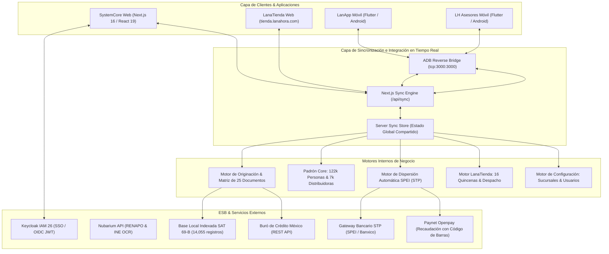

# 🚀 LanAhora SystemCore — Ecosistema Tecnológico & Operativo
**LanAhora (SOFOM E.N.R.)**  
*Plataforma Central de Crédito, Distribuidoras (DVs), LanaTienda a 16 Quincenas, Biometría Facial y Dispersión SPEI*

---

## 📚 Mapa de Documentación Oficial

Para facilitar la navegación del proyecto, la documentación se ha organizado en 4 documentos especializados:

| Documento | Enlace | Audiencia | Contenido Principal |
| :--- | :---: | :---: | :--- |
| **📘 README Técnico** | [`README_TECNICO.md`](README_TECNICO.md) | Desarrolladores / DevOps | Arquitectura de software, Next.js 16, Flutter, Keycloak OIDC, APIs REST, ESB Sync y Guía de Despliegue. |
| **📗 README Público** | [`README_PUBLICO.md`](README_PUBLICO.md) | Público / Clientes / DVs | Guía funcional de módulos, cómo funciona LanaTienda a 16 quincenas fijas, canje digital y FAQ. |
| **🛡️ Bitácora de Ciberseguridad** | [`PRUEBAS_CIBERSEGURIDAD.md`](PRUEBAS_CIBERSEGURIDAD.md) | Seguridad / Auditores | Historial cronológico de pentesting, SAST, RBAC en APIs, listas SAT 69-B, sanitización CSV y anti-vishing. |
| **📊 Presentación Ejecutiva** | [`PRESENTACION_EJECUTIVA.md`](PRESENTACION_EJECUTIVA.md) | Dirección General / Inversionistas | Presentación ejecutiva en 10 diapositivas sobre ROI, digitalización cero papel e impacto financiero. |

---

## 1. Ficha Técnica de la Plataforma

| Parámetro | Especificación |
| :--- | :--- |
| **Framework Web Core** | **Next.js 16.4.5** (App Router, Turbopack Engine, React 19.3.0, TypeScript 5.x) |
| **Estilos & UI System** | Tailwind CSS v4, Lucide Icons, Canvas Signature API |
| **Servidor de Identidad (IAM)** | **Keycloak 26.1.3** (OpenID Connect, Realm `lanahora`, Client `systemcore-web`, PKCE) |
| **Control de Acceso (RBAC)** | Middleware `serverAuth.ts` con validación estricta de roles y alcances territoriales por sucursal |
| **Enrutador Multi-Dominio** | `src/proxy.ts` (Next.js 16 Proxy con soporte estricto para `tienda.lanahora.com`) |
| **Framework Móvil** | **Flutter 3.x / Dart 3.x** (Android SDK 34, JVM 17, Gradle 8.x) |
| **Flavors Móviles** | `lanapp` (`com.lanahora.lanapp`) y `asesores` (`com.lanahora.asesores`) |
| **Seguridad Móvil** | Ofuscación de bytecode con R8 / ProGuard, Flutter Secure Storage (AES-256/RSA) |
| **Gateway ESB & Sync Bus** | RESTful JSON APIs, Serverless Edge Routes, mTLS y Bus de Sincronización Reactivo (`/api/sync`) |
| **Sincronización Multi-Sistema** | Replicación bidireccional inmediata en memoria + BroadcastChannel + ADB Reverse Port 3000 |
| **Estrategia Git** | Tronco central en rama `develop` |

---

## 2. Diagrama de Arquitectura de Sistemas & Bus de Sincronización



---

## 3. Inicio Rápido & Ejecución Local

### 3.1. Requisitos Previos
* **Node.js** >= 18.17 (LTS recomendado v20+)
* **npm** >= 9.x
* **Keycloak** 26.x (opcional para desarrollo; el sistema cuenta con fallback institucional automático)

### 3.2. Instalación y Ejecución
```bash
# Clonar el repositorio
git clone https://github.com/CarlosMartinezLH/SystemCore_LH.git
cd SystemCore_LH

# Cambiar a rama develop
git checkout develop

# Instalar dependencias
npm install

# Iniciar servidor de desarrollo con Turbopack
npm run dev

# Compilar para producción (validación de TypeScript y rutas estáticas)
npm run build
```

La aplicación web estará disponible en:
* **Sistema Core:** `http://localhost:3000`
* **LanaTienda:** `http://localhost:3000/tienda` (o mediante el subdominio `http://tienda.localhost:3000`)

---

## 4. Estructura de Archivos del Proyecto

```text
SystemCore_LH/
├── README.md                                # Índice maestro y guía de navegación
├── README_TECNICO.md                        # Especificación técnica y arquitectura para desarrolladores
├── README_PUBLICO.md                        # Documentación funcional para usuarios y público general
├── PRUEBAS_CIBERSEGURIDAD.md                # Bitácora oficial de pentesting, SAST y mitigaciones
├── PRESENTACION_EJECUTIVA.md                # Presentación de 10 diapositivas para Dirección General
├── keycloak/                                # Configuración y exportaciones de Realm IAM
│   └── data/import/lanahora-realm.json      # Realm OIDC oficial LanAhora (Roles y Clientes)
├── src/
│   ├── app/
│   │   ├── api/
│   │   │   ├── auth/                        # Endpoints de Login y Estado OIDC
│   │   │   ├── configuracion/               # CRUD protegido de Sucursales y Usuarios
│   │   │   ├── kyc/                         # APIs de RENAPO, Biometría y SAT 69-B
│   │   │   ├── sync/                        # Bus reactivo de sincronización Core
│   │   │   └── tienda/                      # Catálogo y procesamiento de pedidos LanaTienda
│   │   ├── tienda/                          # Aplicación Web LanaTienda (Multi-Dominio)
│   │   ├── globals.css                      # Estilos globales y paleta institucional
│   │   ├── layout.tsx                       # Layout raíz
│   │   └── page.tsx                         # Orquestador del Core y control de sesión
│   ├── components/
│   │   ├── Header.tsx                       # Barra de navegación principal del Core
│   │   ├── Sidebar.tsx                      # Menú lateral modular del Sistema Core
│   │   ├── LoginView.tsx                    # Autenticación segura por sucursal
│   │   ├── CoreDashboard.tsx                # Buscador central por DV, Folio y CréditoID
│   │   ├── PersonasView.tsx                 # Padrón de 122,144 personas con sidebar
│   │   ├── DistribuidoresView.tsx           # Padrón de 7,171 distribuidoras con sidebar
│   │   ├── RHView.tsx                       # Asistencia GPS, requisiciones y capacitaciones
│   │   ├── DispersionView.tsx               # Desembolsos SPEI STP y recaudación Paynet
│   │   ├── LanaTiendaAdminView.tsx          # Panel Core de Monitoreo y Despacho de Pedidos
│   │   ├── ConfiguracionView.tsx            # Gestión de Sucursales y Usuarios Institucionales
│   │   └── IntegracionesView.tsx            # Monitor de salud ESB y consola interactiva
│   ├── lib/
│   │   ├── auth/serverAuth.ts               # Middleware de validación JWT y roles RBAC
│   │   ├── utils/csv.ts                     # Sanitizador contra CSV Formula Injection
│   │   ├── store/                           # Almacenes de estado (Tienda y Configuración)
│   │   └── data/                            # Semillas operativas y base SAT Art. 69-B
│   ├── proxy.ts                             # Proxy perimetral multi-dominio Next.js 16
│   └── types/                               # Tipados TypeScript (Core, CRM, Auth, Tienda, Config)
```

---

*Para detalles exhaustivos de código, APIs y despliegue, consulte [`README_TECNICO.md`](README_TECNICO.md).*  
*Para manuales operativos y reglas de negocio de LanaTienda, consulte [`README_PUBLICO.md`](README_PUBLICO.md).*
