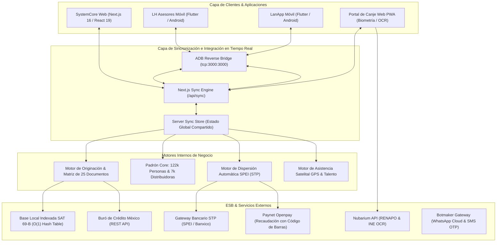
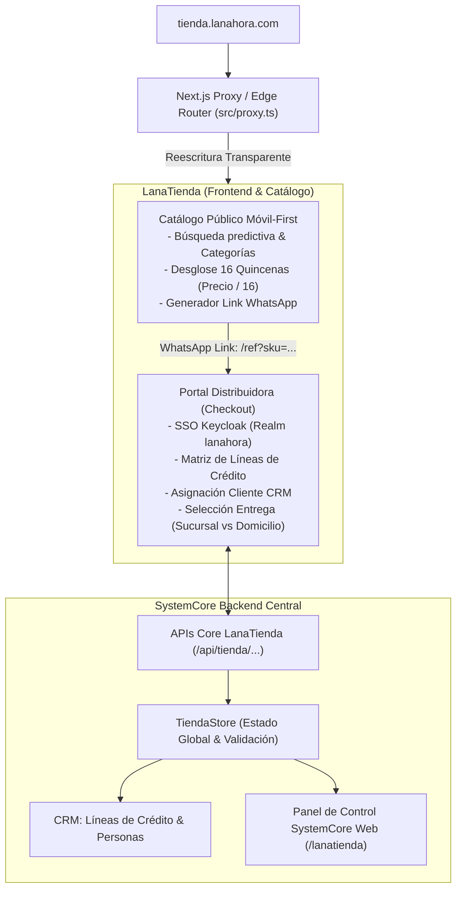

# LanAhora SystemCore — Especificación Técnica & Arquitectura de Software

Núcleo tecnológico, financiero y operativo de **LanAhora (SOFOM E.N.R.)** para la originación, colocación, validación biométrica, dispersión SPEI y administración de créditos mediante vales digitales.

---

## 1. Ficha Técnica del Proyecto

| Parámetro | Especificación |
| :--- | :--- |
| **Framework Web Core** | **Next.js 16.4.5** (App Router, Turbopack Engine, React 19.3.0, TypeScript 5.x) |
| **Estilos & UI System** | Tailwind CSS v4, Lucide Icons, Canvas Signature API |
| **Framework Móvil** | **Flutter 3.x / Dart 3.x** (Android SDK 34, JVM 17, Gradle 8.x) |
| **Flavors Móviles** | `lanapp` (`com.lanahora.lanapp`) y `asesores` (`com.lanahora.asesores`) |
| **Seguridad Móvil** | Ofuscación de bytecode con R8 / ProGuard, Flutter Secure Storage (AES-256/RSA) |
| **Gateway ESB & Sync Bus** | RESTful JSON APIs, Serverless Edge Routes, mTLS y Bus de Sincronización Reactivo (`/api/sync`) |
| **Sincronización Multi-Sistema** | Replicación bidireccional inmediata en memoria + BroadcastChannel + ADB Reverse Port 3000 |
| **Almacenamiento Local** | SQLite encriptado (Mobile), LocalStorage tokenizado (Web) |
| **Estrategia Git** | Tronco central en rama `develop` |

---

## 2. Diagrama de Arquitectura de Sistemas & Bus de Sincronización



---

## 3. Matriz de Sincronización e Integración Multi-Sistema

Cualquier operación ejecutada en uno de los subsistemas se replica **inmediatamente** en los demás sin requerir recargas manuales:

| Evento Disparador | Subsistema Origen | Efecto en SystemCore Web | Efecto en Dispersión STP | Efecto en Red de Distribuidores (DV) | Efecto en App Móvil |
| :--- | :--- | :--- | :--- | :--- | :--- |
| **Canje de Vale Firmado** | LanApp Móvil / Simulador | Pagaré y estatus de cliente actualizados en Padrón de Personas | Se crea registro `DISPERSADO` en STP con folio y clave de rastreo SPEI | Se deduce saldo disponible del distribuidor y aumenta cartera activa | Recibo con clave de rastreo bancario en tiempo real |
| **Captura de Nuevo Cliente** | Personas Core / LanApp | Registro inmediato en tabla de Personas (# PersonaID asignado) | N/A | Cliente disponible para otorgamiento de vales de cualquier DV | Aparece en el buscador de prospectos y clientes de asesores |
| **Registro de Pago / Cobranza** | Dispersión & Pagos / Asesores | Reflejado en matriz de pagos y recibos emitidos | Se concilia la referencia Paynet / SPEI | Se libera línea de crédito y disminuye saldo deudor del distribuidor | Actualización del saldo disponible en tiempo real |
| **Validación KYC / Lista SAT** | App Móvil / Web | Marcado de expediente con resultado O(1) de listas negras SAT | N/A | Bloqueo automático si el cliente aparece en Art. 69-B | Bloqueo preventivo de desembolso antes de firma |

---

## 4. Motor Biométrico & Prueba de Vida (Liveness Detection)

Para garantizar la integridad en el canje de vales digitales sin costos por consultas externas innecesarias, el sistema implementa un motor biométrico asistido en 4 fases dentro de la misma aplicación (sin saltar a la app externa de cámara):

1. **Protocolo Previo de Verificación:** Diálogo modal que bloquea el inicio hasta que el usuario confirme expresamente haberse retirado lentes (graduados o de sol), gorras y cubrebocas.
2. **Fase 1 (Alejamiento & Centrado):** Alerta en pantalla `↔️ ALEJE EL TELÉFONO - Centre su rostro dentro del óvalo` con marco dinámico azul.
3. **Fase 2 (Acercamiento Progresivo):** Alerta en pantalla `🔍 ACÉRQUESE LENTAMENTE - Ajuste su rostro al óvalo` con marco dinámico ámbar.
4. **Fase 3 (Verificación sin Lentes & Parpadeo):** Alerta en pantalla `👁️ SIN LENTES Y PARPADEE - Mire a la cámara` con marco dinámico azul cielo.
5. **Fase 4 (Captura en Distancia Perfecta):** Alerta `✓ ¡DISTANCIA PERFECTA! Manténgase inmóvil...` con marco dinámico verde esmeralda y captura automática del frame en alta resolución.

---

## 3. Motores de Negocio & Módulos Técnicos

### 3.1. Motor KYC & Filtro de Listas Negras SAT (`/api/kyc/validate-curp`)
* **Endpoint:** `POST /api/kyc/validate-curp`
* **Mecanismo de Ejecución:**
  1. **Validación Sintáctica Estricta:** Comprobación mediante expresión regular oficial para CURP (`^[A-Z]{4}\d{6}[HM][A-Z]{2}[B-DF-HJ-NP-TV-Z]{3}[A-Z\d]\d$`).
  2. **Consulta a RENAPO vía Nubarium:** Extracción de nombres, apellidos, género y fecha de nacimiento oficial con token JWT (`Bearer`).
  3. **Búsqueda In-Memory SAT Art. 69-B:** Diccionario hash JSON (`sat_69b_index.json`) precompilado en memoria con tiempo de acceso $O(1)$ para descartar EFOS/EDOS (contribuyentes en lista negra definitiva, presunta o con sentencia).

### 3.2. Motor de Dispersión Bancaria STP SPEI
* **Protocolo:** JSON REST / mTLS con firma criptográfica RSA-SHA256.
* **Flujo de Ejecución:**
  1. Generación de `claveRastreo` única estructurada: `LAN{YYYYMMDD}{FOLIO_ALEATORIO}`.
  2. Firma del payload con llave privada de la SOFOM (`STP_PRIVATE_KEY`).
  3. Despacho hacia el concentrador de STP y recepción de folio de liquidación.
  4. Consulta del Comprobante Electrónico de Pago (CEP) ante el Banco de México (Banxico).

### 3.3. Motor de Geoposicionamiento & Asistencia GPS
* **Tecnología:** HTML5 High Accuracy Geolocation API en Web + Geolocator en Flutter.
* **Precisión:** Adquisición satelital con `enableHighAccuracy: true`, validando latitud, longitud, altitud y distancia radial contra el polígono de la sucursal o ruta de prospección.

### 3.4. Motor de Canje Digital & Biometría Facial
* **Captura de Documentos:** Cámara trasera en modo `environment` con resolución nativa 1080p y preprocesamiento de imagen en Canvas (conversión Base64 y extracción OCR de código bidimensional PDF417).
* **Selfie Biométrica Facial:** Cámara frontal en modo `user` con detección de vida (*liveness detection*), cálculo de distancia interocular y comparación facial contra la fotografía extraída del INE.

---

## 4. Ciberseguridad & Pentesting Hardening

El sistema cuenta con directivas de seguridad implementadas y verificadas contra ataques de inyección, secuestro de clics y robo de credenciales:

```typescript
// next.config.ts — Encabezados HTTP de Seguridad
headers: [
  { key: 'X-Frame-Options', value: 'DENY' },
  { key: 'X-Content-Type-Options', value: 'nosniff' },
  { key: 'Strict-Transport-Security', value: 'max-age=63072000; includeSubDomains; preload' },
  { key: 'Referrer-Policy', value: 'strict-origin-when-cross-origin' },
  { key: 'Permissions-Policy', value: 'camera=(self), microphone=(), geolocation=(self)' },
  { key: 'Content-Security-Policy', value: "default-src 'self'; script-src 'self' 'unsafe-eval' 'unsafe-inline'; style-src 'self' 'unsafe-inline'; img-src 'self' data: blob: https:; font-src 'self' data:; connect-src 'self' http://127.0.0.1:* http://localhost:* https://api.nubarium.com https://*.sat.gob.mx;" }
]
```

### Reglas de Ofuscación R8 / ProGuard (`mobile_app/android/app/proguard-rules.pro`)
* Retención de componentes Flutter esenciales (`io.flutter.app.**`, `io.flutter.plugin.**`).
* Supresión de advertencias en dependencias diferidas (`-dontwarn com.google.android.play.core.**`).
* Protección contra ingeniería inversa en SQLite y almacenamiento encriptado seguro (`FlutterSecureStorage`).

---

## 5. Estructura de Directorios

```text
SystemCore_LH/
├── docs/                                    # Especificaciones de arquitectura interna
│   ├── core-central.md                      # Arquitectura del Core Central LanAhora
│   ├── proceso-originacion-crm.md           # Pipeline comercial de 8 etapas
│   ├── capital-humano-rh.md                 # Control de Asistencia satelital GPS
│   ├── diseno-login-movil.md                # Design System corporativo y pantallas móviles
│   ├── manual-dispersion-digital-lanapp.md  # Protocolo de canje y dispersión STP
│   └── mapa-sistemas-integraciones.md       # Topología de la capa de integración ESB
├── src/
│   ├── app/
│   │   ├── api/kyc/validate-curp/route.ts   # Edge API de validación RENAPO + SAT 69-B
│   │   ├── globals.css                      # Estilos globales y paleta institucional
│   │   ├── layout.tsx                       # Layout raíz
│   │   └── page.tsx                         # Orquestador del Core y control de sesión
│   ├── components/
│   │   ├── Header.tsx                       # Barra de navegación principal del Core
│   │   ├── LoginView.tsx                    # Autenticación segura por sucursal
│   │   ├── KanbanBoard.tsx                  # Tablero visual de originación
│   │   ├── TableView.tsx                    # Vista tabular de prospectos comerciales
│   │   ├── LeadDetailView.tsx               # Expediente comercial y matriz de 25 documentos
│   │   ├── CoreDashboard.tsx                # Buscador central por DV, Folio y CréditoID
│   │   ├── PersonasView.tsx                 # Padrón de 122,144 personas con sidebar
│   │   ├── DistribuidoresView.tsx           # Padrón de 7,171 distribuidoras con sidebar
│   │   ├── RHView.tsx                       # Asistencia GPS, requisiciones y capacitaciones
│   │   ├── DispersionView.tsx               # Desembolsos SPEI STP y recaudación Paynet
│   │   ├── IntegracionesView.tsx            # Monitor de salud ESB y consola interactiva
│   │   ├── LanAppView.tsx                   # Simulador Web de LanApp y Canje con Cámara
│   │   └── modals/                          # Modales de interacción operativa
│   ├── lib/
│   │   ├── data/
│   │   │   ├── coreData.ts                  # Padrón de semillas operativas
│   │   │   ├── initialData.ts               # Semillas de prospectos y matriz documental
│   │   │   └── sat/sat_69b_index.json       # Padrón indexado de contribuyentes SAT Art. 69-B
│   │   └── security.ts                      # Sanitizadores y hashing criptográfico
│   └── types/                               # Tipados TypeScript (Core, CRM, Auth, RH)
├── DOCUMENTACION_GENERAL.md                 # Documentación funcional para público en general
└── README.md                                # Este documento (Especificación técnica)
```

---

## 6. Variables de Entorno (`.env.local`)

```env
# Configuración del Entorno
NEXT_PUBLIC_APP_ENV=development
NEXT_PUBLIC_APP_URL=http://localhost:3000

# API Nubarium KYC (RENAPO & Biometría)
NUBARIUM_BASE_URL=https://api.nubarium.com
NUBARIUM_AUTH_USER=nubarium
NUBARIUM_AUTH_PASSWORD=_nub4r1mp4ssw0rd.
NUBARIUM_API_KEY=

# Gateway Bancario STP SPEI
STP_BASE_URL=https://mpos.insis.com.mx
STP_EMPRESA=LANA_AHORA_SOFOM
STP_CUENTA_ORDENANTE=646180157000000004

# Paynet / OpenPay Recaudación
OPENPAY_MERCHANT_ID=
OPENPAY_PRIVATE_KEY=
```

---

## 7. Compilación & Despliegue

### 7.1. Sistema Web Core
```bash
# Instalación de dependencias
npm install

# Modo desarrollo con Turbopack
npm run dev

# Compilación de producción (Validación TypeScript y optimización de estáticos)
npm run build

# Ejecución en producción
npm run start
```

### 7.2. Aplicaciones Móviles (Flutter / Android)
```bash
cd mobile_app

# Compilar APK Release de LanApp (Distribuidoras & Canje):
flutter build apk --flavor lanapp -t lib/main_lanapp.dart

# Compilar APK Release de LH Asesores (Fuerza de Ventas en Campo):
flutter build apk --flavor asesores -t lib/main_asesores.dart

# Instalación en dispositivo físico vía ADB:
adb -s <DEVICE_ID> install -r build/app/outputs/flutter-apk/app-lanapp-release.apk
adb -s <DEVICE_ID> install -r build/app/outputs/flutter-apk/app-asesores-release.apk
```

---

## 8. LanaTienda (`tienda.lanahora.com`) — E-Commerce B2B2C & SystemCore

Módulo oficial de comercio electrónico donde los clientes eligen productos del catálogo institucional y los adquieren a través de la línea de crédito de su Distribuidora autorizada a **16 quincenas fijas**.

### 8.1. Arquitectura Técnica & Enrutamiento Multi-Dominio



### 8.2. Reglas de Negocio Oficiales (Manuales LNH-LTD-MAN-001 / 002 / 003)

1. **Cálculo Financiero Obligatorio:** Todo producto se financia de manera inamovible a **16 quincenas fijas** calculadas como:
   $$\text{Pago Quincenal} = \frac{\text{Precio Contado}}{16}$$
   *(No incluye seguro de canje opcional).*
2. **Garantía y Entrega:**
   - Plazo de entrega típico: 5 a 10 días hábiles.
   - El cliente dispone de **48 horas hábiles** posteriores a la entrega para reportar incidencias de producto dañado o incompleto.
3. **Flujo de Referencia por WhatsApp:**
   - El cliente no requiere registrarse para navegar; al presionar **"¡Compra con tu distribuidora aquí!"**, se genera un enlace deep-link `https://tienda.lanahora.com/ref?sku=XYZ` que abre WhatsApp con el mensaje pre-redactado para su distribuidora.
4. **Matriz de Líneas de Crédito de la Distribuidora:**
   - **Línea LanaTienda:** Monto total autorizado y disponible para compras de sus clientes.
   - **Línea Personal:** Monto total autorizado y disponible para compras propias.
   - **Límite Cliente Final por Nivel:** (ej. Nivel Bronce: \$9,000 MXN) del cual se deducen los Vales activos con canje y Kits de belleza para determinar la capacidad de compra del cliente.
5. **Modalidades de Entrega:**
   - **Opción A (Sucursal):** Entrega en mostrador de la sucursal asignada a la distribuidora (ej. *Saltillo Centro*).
   - **Opción B (Domicilio Cliente):** Envío a la dirección registrada en el CRM del cliente, requiriendo de forma obligatoria el campo de **Referencias del Domicilio** (color de fachada, tipo de portón, entrecalles).

### 8.3. Endpoints REST Core

| Endpoint | Método | Descripción |
| :--- | :--- | :--- |
| `/api/tienda/catalog` | `GET` | Catálogo de productos, categorías y cálculo quincenal. Soporta filtros `?q=`, `?categoria=` y `?sku=`. |
| `/api/tienda/distribuidora` | `GET` | Consulta de líneas autorizadas, disponibles, nivel y cartera de clientes asignados a la distribuidora. |
| `/api/tienda/pedidos` | `GET` | Listado de pedidos generados (filtrable por `?distribuidoraId=`). |
| `/api/tienda/pedidos` | `POST` | Creación de pedido, validación de línea de crédito, deducción de saldo y generación de folio `LTD-2026-XXXX`. |
| `/api/tienda/pedidos/[id]` | `PATCH` | Actualización de estatus (`APROBADO_MESA`, `EN_TRANSITO`, `LISTO_SUCURSAL`, `ENTREGADO`, `CANCELADO`) y asignación de guía. |

