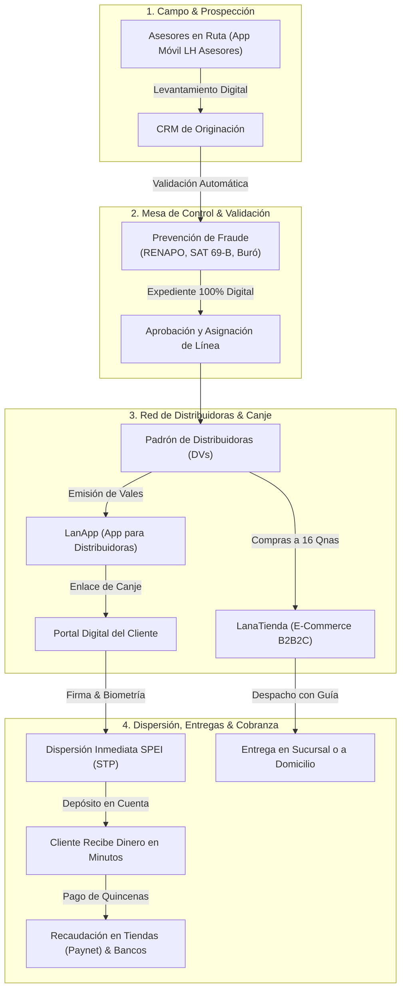

# LanAhora SystemCore — Plataforma Integral de Crédito y Operaciones
**Documentación Funcional para Usuarios y Público en General**

Bienvenido a la documentación oficial de **LanAhora SystemCore**, la plataforma digital integral diseñada para respaldar, agilizar y modernizar el modelo de colocación, administración, comercio electrónico y cobranza de microcréditos mediante vales en México.

---

## 🎯 ¿Qué es LanAhora SystemCore?

**LanAhora SystemCore** es el ecosistema operativo y tecnológico de **LanAhora (SOFOM E.N.R.)**. Conecta en una sola plataforma segura y en tiempo real a:

* **Dirección General y Mesas de Control**: Para monitorear la salud financiera, autorizar compras en línea, dispersiones bancarias y verificar cumplimiento regulatorio.
* **Coordinadores y Gerentes de Sucursal**: Para supervisar la cobranza, autorizar expedientes, gestionar sucursales físicas y coordinar equipos de campo.
* **Asesores de Campo**: Equipados con su aplicación móvil para prospectar clientes en ruta y validar identidades con biometría al instante.
* **Distribuidoras (DVs)**: Que administran sus líneas de crédito, emiten vales digitales a sus clientes, adquieren artículos a plazos y consultan sus estados de cuenta quincenales desde su propia app (**LanApp**).
* **Clientes Finales**: Quienes reciben préstamos ágiles, compran artículos a 16 quincenas fijas en **LanaTienda**, firman digitalmente y disponen de su dinero en minutos vía transferencia electrónica bancaria o en comercios afiliados.

---

## 🏛️ Los Pilares del Sistema

---

## 📦 Módulos Principales del Sistema

### 1. CRM & Originación Comercial (Cero Papel)
* **Tablero Kanban de Crédito**: Seguimiento visual paso a paso de cada prospecto a través de sus etapas reglamentarias: Contacto inicial, Visita ocular en domicilio/negocio, Consulta en Buró, Integración de expediente, Mesa de Control y Autorización final.
* **Expediente Digital Centralizado**: Almacena de forma ordenada y encriptada los 25 documentos de respaldo requeridos (identificaciones oficiales, comprobantes de domicilio, fotos de fachada/interior, cartas de aval y contratos).
* **Dictamen de Capacidad**: Clasificación automática del perfil de la distribuidora según su nivel de solvencia y experiencia previa.

### 2. Padrón Central de Personas y Expediente Digital
* **Búsqueda Instantánea**: Localización ágil de clientes y distribuidores entre más de 122,000 registros por nombre, CURP o número de expediente.
* **Historial Completo**: Visualización de antecedentes crediticios, pagarés firmados, documentación digitalizada y cartas declaratorias.
* **Exportación Segura**: Descarga de reportes en Excel/CSV con protección criptográfica contra inyección de fórmulas (CWE-1236).

### 3. Red de Distribuidoras (DVs)
* **Control Integral de Cartera**: Consulta de líneas de crédito activas, saldo actual, disponibilidad para emisión de vales y estatus de cobranza.
* **Estados de Cuenta Oficiales**: Generación y descarga inmediata de estados de cuenta detallados con desglose de cargos, pagos y comisiones.
* **Relación de Cobro Quincenal**: Listados ordenados por coordinador y sucursal para agilizar el corte y la cobranza en campo.
* **Comunicación Directa**: Envío de avisos oficiales, notificaciones push a la aplicación móvil y recordatorios vía WhatsApp.

### 4. LanaTienda (`tienda.lanahora.com`) — Comercio Electrónico a 16 Quincenas
* **Catálogo Oficial en Línea**: Tienda digital accesible para todo el público con productos de alta demanda (telefonía celular, electrodomésticos, pantallas, cómputo y kits de belleza).
* **Esquema Financiero a 16 Quincenas Fijas**: Todos los precios incluyen el cálculo transparente del pago quincenal ($\text{Precio} / 16$) sin cobros ocultos ni anticipos obligatorios.
* **Botón "¿Cómo Comprar? ¡Con tu Distribuidora!"**: Cualquier cliente puede seleccionar un artículo y generar con un solo toque un enlace oficial de WhatsApp con el producto y precio preconfigurados para enviarlo a su distribuidora autorizada.
* **Portal de Checkout para Distribuidoras**:
  - Acceso seguro mediante inicio de sesión con credenciales institucionales (Keycloak SSO).
  - Consulta en tiempo real de su línea de crédito exclusiva de LanaTienda y saldo disponible.
  - Asignación al cliente final registrado en su cartera.
  - Selección de modalidad de entrega: en mostrador de su **Sucursal LanAhora** o con envío directo **a Domicilio** del cliente.
* **Monitoreo Administrativo en Sistema Core**: Mesa de Crédito supervisa cada pedido generado, autoriza la compra contra la línea disponible, captura la guía de paquetería (FedEx, Estafeta) y valida la entrega final.
* **Garantía y Calidad**: Cobertura de garantía de 48 horas hábiles tras la recepción para reporte de incidencias o reemplazo inmediato.

### 5. Configuración del Sistema Core: Sucursales y Usuarios
* **Administración de Sucursales Físicas**: Módulo central para registrar nuevas plazas y sucursales (Saltillo, Torreón, Monclova, etc.), editar datos de contacto, cambiar nombres con actualización en cascada y gestionar el estatus operativo (`ACTIVA` / `INACTIVA`).
* **Usuarios Institucionales & Control de Acceso (RBAC)**: Alta y administración de directores, analistas de mesa de crédito, coordinadores comerciales y asesores de campo, definiendo su alcance territorial (`ALL` para supervisión global o `BRANCH` para una sola sucursal).

### 6. Validación de Identidad y Prevención de Fraude (KYC & Cumplimiento)
* **Validación RENAPO**: Comprobación oficial de existencia, vigencia y coherencia de datos de la Clave Única de Registro de Población (CURP).
* **Filtro de Listas Negras del SAT (Art. 69-B)**: Verificación instantánea (<2ms) contra el padrón oficial completo de 14,055 contribuyentes del SAT por operaciones simuladas (EFOS/EDOS).
* **Consulta en Buró de Crédito**: Conexión directa para obtener el Score crediticio (FICO) y comportamiento de pago previo en segundos.

### 7. Dispersión Automática SPEI y Recaudación de Pagos
* **Dispersión Inmediata 24/7 (STP SPEI)**: Envío automático del dinero a la cuenta bancaria (CLABE o tarjeta) del cliente en minutos una vez completado el canje. Generación de clave de rastreo oficial para consulta en Banxico.
* **Red de Cobranza en Tiendas (Paynet)**: Generación de códigos de barras para que los clientes o distribuidoras realicen sus abonos cómodamente en más de 30,000 establecimientos en todo el país (7-Eleven, Farmacias del Ahorro, Circle K, Walmart y ventanillas bancarias).

### 8. Aplicaciones Móviles Oficiales (Multiplataforma: iPhone iOS & Google Android)

El ecosistema móvil de LanAhora está desarrollado con tecnología **Flutter de última generación**, lo que garantiza que tanto **LanApp** como **LH Asesores** están disponibles y funcionan de forma nativa e idéntica tanto en **Apple iPhone (iOS 15+)** como en **Google Android**:

#### 📱 LanApp (Para Distribuidoras y Canje del Cliente)
* **Compatibilidad Total**: Disponible para **iPhone** (con soporte nativo para **Face ID**, Touch ID y compartir vales vía WhatsApp) y para teléfonos **Android**.
* **Para la Distribuidora**:
  * Consulta en tiempo real de su saldo disponible y fechas de corte.
  * Emisión de vales de dinero digitales especificando monto y quincenas.
  * Generación de enlaces seguros para enviar a sus clientes por WhatsApp.
* **Para el Cliente Final (Canje Digital & Validación Asistida)**:
  * Proceso de autoservicio guiado desde cualquier iPhone o Android:
    1. Confirmación de datos personales, domicilio y beneficiario de seguro de vida.
    2. Captura en vivo de fotografía de su credencial INE (anverso y reverso) con lectura automática de datos.
    3. **Validación Biométrica Asistida en Vivo**:
       - Bloqueo preventivo y confirmación obligatoria para retirar lentes y gorra (con detector neuronal ShuffleNet).
       - Guía dinámica de 4 pasos en pantalla con cambios de color: alejamiento, acercamiento progresivo al óvalo, parpadeo sin lentes y captura en distancia óptima.
    4. Firma digital del pagaré en pantalla táctil con validez legal.
    5. Depósito automático directo a su cuenta de banco (SPEI STP).

#### 📱 LH Asesores (Para Asesores Comerciales en Ruta)
* **Compatibilidad**: Funciona en dispositivos **Android** y **iPhone** para asesores de campo y supervisores.
* **Levantamiento en Campo**: Registro de nuevas solicitudes de crédito directamente en el domicilio o negocio del prospecto, sin necesidad de cargar papelería física.
* **Validación en Frío**: Verificación de CURP en tiempo real durante la entrevista para descartar homónimos o adeudos previos antes de armar expediente.
* **Asistencia y Geolocalización**: Registro de visita con coordenadas GPS para transparentar la cobertura de zonas comerciales asignadas.

---

## ⚡ Integración y Sincronización en Tiempo Real

El sistema cuenta con un **motor de integración automática bidireccional**. Lo que se ejecute en un subsistema se refleja **inmediatamente** en los demás:
* **Canje en LanApp ➡️ Dispersión STP & Cartera**: En cuanto el cliente concluye su firma en el teléfono, se genera la orden de dispersión bancaria en la mesa de control de **SystemCore**, se descuenta el cupo disponible de la distribuidora y se registra el pagaré del cliente.
* **Compra en LanaTienda ➡️ Línea de Crédito & Mesa de Control**: Al procesar una orden de compra, se descuenta de la línea de crédito de la distribuidora y aparece en el panel de **LanaTienda** del Core para aprobación y despacho con paquetería.
* **Nuevo Cliente ➡️ Padrón Core & CRM**: Al dar de alta a una persona desde la app o el panel central, queda disponible al instante en el padrón central de **Personas** para que cualquier distribuidora autorizada pueda emitirle vales.
* **Cobranza ➡️ Recuperación de Línea**: Al registrar un abono en tiendas de conveniencia (Paynet) o ventanilla bancaria, la distribuidora ve liberada su línea de crédito al momento para continuar otorgando préstamos sin interrupciones.

---

## 🔒 Compromiso con la Seguridad y Prevención de Fraude

LanAhora opera bajo los más altos estándares de ciberseguridad financiera:
* **Autenticación Unificada (SSO Keycloak)**: Acceso institucional centralizado mediante protocolo OpenID Connect (OIDC) y tokens criptográficos JWT.
* **Control de Acceso Basado en Roles (RBAC)**: Cada usuario únicamente puede ver y modificar la información autorizada según su sucursal y perfil operativo.
* **Cabeceras de Blindaje Web**: Protección activa con CSP, HSTS a 2 años con preload, bloqueo de Clickjacking (`X-Frame-Options: DENY`) y prevención de rastreo (`nosniff`).
* **Protección Anti-Ingeniería Social (Vishing & Phishing)**:
  - Avisos preventivos en la tienda y mensajes oficiales: *"LanAhora NUNCA te pedirá transferencias a cuentas OXXO o personales"*.
  - Bloqueo preventivo de cuentas tras intentos fallidos repetidos.
* **Bitácora de Ciberseguridad Transparente**: Todo el historial de pruebas, escaneos de vulnerabilidades y correcciones técnicas se documenta y audita en el archivo [`PRUEBAS_CIBERSEGURIDAD.md`](PRUEBAS_CIBERSEGURIDAD.md).

---

## ❓ Preguntas Frecuentes (FAQ)

### ¿Se necesita una computadora potente para usar el sistema Core?
No. SystemCore está desarrollado con tecnología web de última generación optimizada para cargar en milisegundos en cualquier navegador moderno (Google Chrome, Microsoft Edge, Safari o Firefox), ya sea en computadoras de escritorio, laptops o tabletas.

### ¿Cómo compra un cliente en LanaTienda si no tiene cuenta bancaria?
El cliente no necesita tarjeta de crédito ni cuenta bancaria. Simplemente entra a `tienda.lanahora.com`, elige su producto y pulsa el botón de WhatsApp para contactar a su Distribuidora LanAhora. La distribuidora lo procesa con su línea autorizada y el cliente lo paga en 16 abonos quincenales cómodos.

### ¿Qué pasa si un asesor pierde la conexión a internet en campo?
La aplicación móvil de asesores cuenta con almacenamiento local seguro en el dispositivo, permitiendo avanzar en la captura de datos y fotografías para sincronizarlas en cuanto recupere cobertura celular o señal Wi-Fi.

### ¿Cómo sabe el cliente final que su dinero ya fue depositado?
En cuanto el cliente concluye la firma digital y la prueba de vida en el portal de canje, el motor SPEI realiza la transferencia en tiempo real y el cliente recibe confirmación en pantalla junto con su comprobante digital y clave de rastreo bancaria oficial de Banxico.
