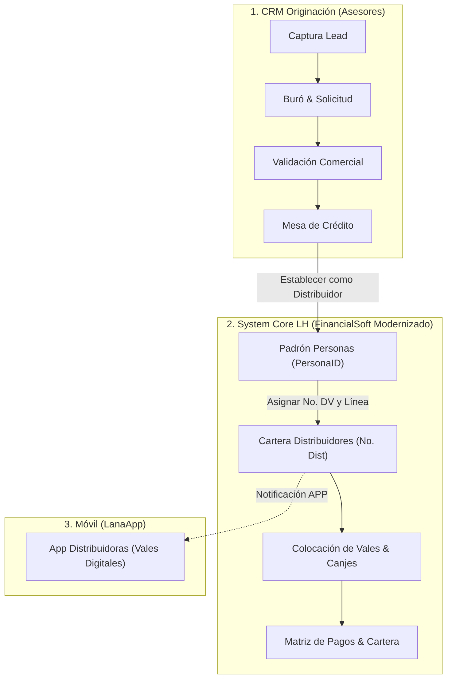

# Arquitectura del Sistema Core Principal (FinancialSoft + CRM)

**Propósito:** Unificar y modernizar el sistema central **FinancialSoft** (actualmente en ASP.NET) con el **CRM de Originación (Odoo)** en una sola plataforma robusta, rápida e integrada: **SystemCore_LH**.

---

## 1. Módulos del Sistema Core (FinancialSoft)

A partir de la inspección directa del sistema en producción (`lanahora.financialsoft.com.mx`), se identifican los siguientes pilares:

### A. Buscador Central y Mesa de Control
* **Búsqueda rápida por:**
  1. No. de DV (Número de Distribuidora).
  2. CreditoID (Identificador del crédito).
  3. No. de Vale (Folio físico o digital de vale).
  4. Nombre del distribuidor / cliente.
* **Alertas Rápidas:**
  - Notas de gestoría / cobranza.
  - Reportes anónimos de PLD (Prevención de Lavado de Dinero y Financiamiento al Terrorismo).

---

### B. Módulo de Personas (Padrón Único de Clientes y Avales)
* **Atributos Clave:**
  - `Persona ID` (Identificador único incremental, ej. 122144).
  - Nombre(s), Apellido Paterno, Apellido Materno.
  - Fecha de Nacimiento, Sexo ID (Femenino / Masculino).
  - CURP y RFC.
  - `Pagaré Estatus ID` (No Definido, Firmado en Blanco, Sin Pagaré) y Cantidad.
  - `Buró Interno Estatus`: Normal, No Sujeto de Crédito, Bloqueado.
  - Observaciones.
* **Operaciones / Acciones Laterales:**
  - Captura rápida de cliente.
  - Solicitar buró.
  - **Establecer como distribuidor** (Puente directo con la activación del CRM).
  - Historial de créditos.
  - Datos bancarios.
  - Expediente digital (Visor de documentos).
  - Canjear vale.
  - Solicitud de crédito.
  - Imprimir carta prestanombres.
  - Relacionar con distribuidor.
  - Enlace con Documentos Odoo.
  - Exportar a Excel.

---

### C. Módulo de Distribuidores (Red Comercial de Vales)
* **Padrón de más de 7,100 distribuidores activos e históricos:**
  - `No. Dist` (Folio único, ej. 1001, 1002...).
  - Nombre del Distribuidor.
  - Sucursal (Saltillo, Torreón, etc.).
  - Zona y Subzona.
  - Coordinador de Negocios asignado (ej. Rosario Charles, Karla Edith Quiroz, Reyna Gutiérrez...).
  - Estatus del distribuidor: `ACTIVO`, `CANCELADO`, `REESTRUCTURA`.
  - Nivel de Distribuidora: `BRONCE`, `PLATA`, `ORO`, `DIAMANTE`.
* **Herramientas de Operación:**
  - Detalle de la distribuidora y módulo de Cartera.
  - Relación de cobranza y relación de recibos.
  - Estado de cuenta detallado.
  - Mensajes masivos y notificaciones Push a la APP móvil (*LanaApp*).
  - Quitar fecha de castigo.

---

### D. Conexión Integral: Del CRM al Core

