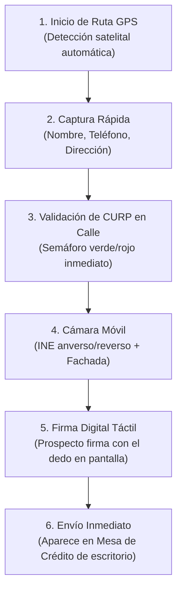

# Sistema de Diseño Unificado, Login & App Móvil de Prospección

**Propósito:** Establecer los lineamientos visuales, experiencia de autenticación institucional y el flujo móvil para la fuerza de ventas en calle de **LanAhora SystemCore**.

---

## 1. Paleta de Colores & Sistema de Diseño Unificado

Se reemplazó la mezcla heterogénea previa por un **Design System Fintech Ejecutivo** con identidad LanAhora:

| Token / Color | Hex | Aplicación |
| :--- | :---: | :--- |
| **LanAhora Gold / Amber** | `#f59e0b` / `#fbbf24` | Botones de acción primaria, badges de estatus activo, acentos de marca. |
| **Dark Executive Slate** | `#0c101c` | Fondo principal del sistema (modo oscuro ejecutivo). |
| **Card Surface** | `#131a2b` / `#172138` | Paneles de tarjetas, tablas y modales. |
| **Borders & Dividers** | `#1e293b` / `#232f48` | Delimitadores sutiles de alta definición. |
| **Emerald Success** | `#10b981` | CURP válida, personal puntual, créditos vigentes. |
| **Rose Alert** | `#f43f5e` | Prospecto no sujeto de crédito, atrasos, rechazos. |
| **Blue & Indigo** | `#3b82f6` / `#6366f1` | Padrón de personas, cartera de distribuidores y RH. |

---

## 2. Pantalla de Inicio de Sesión Institucional (`LoginView`)
* Identidad visual LanAhora con el lema corporativo *«¡En Ti confiamos!»*.
* Formulario con selector de **Sucursal** (Corporativo Saltillo, Saltillo Centro, Torreón Matriz, Monclova Foránea).
* **Selector rápido de roles para pruebas en 1 clic:**
  - **Director General / Administrador** (`JOSE CARLOS MARTINEZ MAYORGA`).
  - **Asesor en Calle (App Móvil)** (`CINDY KARIME LOPEZ GARCIA`).
  - **Coordinador Comercial** (`ESAU ESPINOZA`).
  - **Mesa de Crédito** (`LORENA DE LA TORRE`).
* Persistencia segura de sesión en el navegador y botón de cierre de sesión en todos los módulos.

---

## 3. App Móvil de Prospección en Campo (`MobileAdvisorApp`)

Diseñada específicamente para los teléfonos móviles de los asesores de crédito en cambaceo, plantón o sectores INEGI:

* **Características Clave de la App Móvil:**
  - Formato adaptado a pantalla táctil (smartphone mockup en escritorio y 100% responsivo en celular).
  - Georreferenciación GPS obligatoria al abordar al prospecto.
  - Firma en canvas táctil para que el prospecto firme con el dedo al instante.
  - Validación de CURP en ruta contra Financialsoft para evitar integrar expedientes inviables.

