# Mapa de Sistemas e Integraciones — LanAhora Core

Documento basado en el diagrama oficial de infraestructura y ecosistema de sistemas de LanAhora.

---

## 1. Mapa de Sistemas e Integraciones

```mermaid
flowchart TD
    subgraph Canales ["CANALES / FRONTEND"]
        AppDV["App DV (Android / iOS)"]
        AppOficina["App Mi Oficina Virtual (Android)"]
        AppCliente["App Cliente Final"]
        Lanatienda["Lanatienda (Promologistics / TKS)"]
        CallCenter["Call Center"]
        Bot["Botmaker (WhatsApp / SMS)"]
    end

    subgraph Gateway ["CAPA DE INTEGRACIÓN (API Gateway / ESB)"]
        ESB["API Gateway / ESB (REST / SOAP / JSON / XML)"]
    end

    subgraph Core ["CORE FINANCIALSOFT"]
        Prospectos["Prospectos"]
        Clientes["Clientes Finales (122k)"]
        Distribuidores["Distribuidores (7.1k)"]
        Creditos["Créditos y Vales"]
        Dispersion["Dispersión (STP / Banorte)"]
        Pagos["Pagos & Recaudación"]
        Cobranza["Cobranza & Cartera"]
        Contabilidad["Contabilidad"]
        Reportes["Reportes"]
    end

    subgraph Externas ["INTEGRACIONES EXTERNAS"]
        Buro["Buró de Crédito México"]
        STP["STP (SPEI / Dispersión)"]
        Banorte["Banorte (Pagos)"]
        ClubPago["Club Pago"]
        Paynet["Paynet / Openpay (7-Eleven / Farmacias)"]
        Nubarium["Nubarium (CURP RENAPO / INE OCR / SAT 69-B)"]
        Odoo["CRM Odoo (Originación)"]
    end

    Canales --> Gateway
    Gateway --> Core
    Core <--> Externas
```

---

## 2. Diagrama de Infraestructura y Ambientes

* **Firewall Perimetral**: OPNsense con IDS / IPS y filtrado SSL / TLS.
* **Balanceador de Carga**: NGINX / IIS como Proxy Inverso.
* **Servidor de Aplicaciones y Microservicios**:
  - Motor de reglas de crédito y perfiles (`D-AAA` a `E-A`).
  - Servicios de integración financiera (STP, Buró, Paynet).
  - Tareas programadas (Jobs / Cron) para cortes quincenales y cobranza.
* **Base de Datos**: Microsoft SQL Server 2022 Essentials (Servidor Principal y Réplica Espejo).
* **Almacenamiento**: Almacenamiento seguro de expedientes KYC (Nextcloud Storage / SFTP).
* **Ambientes**:
  1. `DEV`: Desarrollo local y pruebas unitarias.
  2. `QA / Test`: Control de calidad y pruebas de aceptación de usuario.
  3. `STG`: Preproducción y simulaciones de integración financiera.
  4. `PRD`: Producción 24/7.

---

## 3. Stack Tecnológico

| Capa | Tecnologías | Frameworks & Herramientas |
| :--- | :--- | :--- |
| **Frontend Web** | HTML5, CSS3, JavaScript, TypeScript | Next.js 16 (App Router), Tailwind CSS, Lucide |
| **Aplicación Móvil** | Dart, Kotlin, Java | Flutter 3.47, Android SDK (API 33-36), Gradle 9.3 |
| **Backend & APIs** | C# .NET Core, TypeScript, REST / SOAP | Microservicios REST, Web API, JSON-RPC |
| **Base de Datos** | T-SQL, SQL Server 2022 | Backups automáticos y replicación espejo |
| **Seguridad & Auth** | JWT, OAuth2, OTP, mTLS X.509, VPN IPsec | Cumplimiento CNBV, PLD / FT, SAT 69-B |
| **Comunicaciones** | Botmaker Meta Cloud API, SMS, Twilio | Notificaciones de cobranza, alertas y recordatorios de corte |

